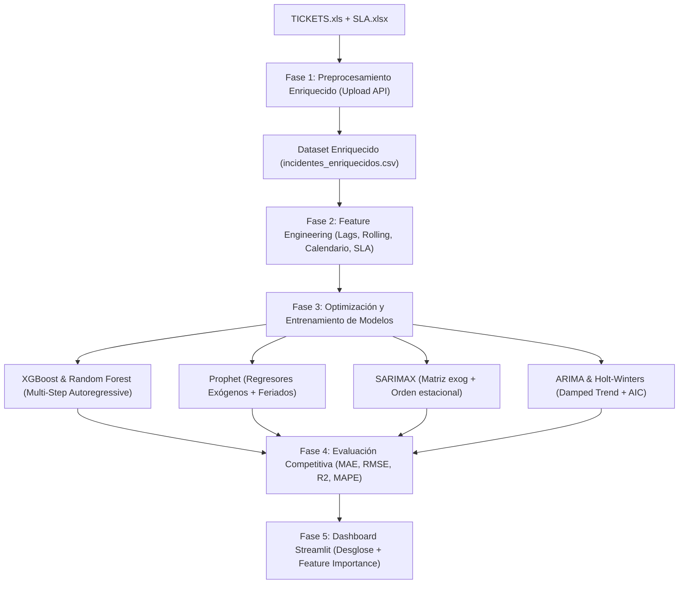

# Plan de Implementación: Mejora de Precisión en Modelos de Proyección de Incidentes

## 1. Contexto y Diagnóstico del Estado Actual

### 1.1. Diagnóstico del Dataset (`TICKETS.xls`)
El archivo maestro contiene **4,910 registros** y **30 columnas** que abarcan del **01 de febrero al 30 de abril de 2026** (89 días continuos), con un promedio de **55 tickets diarios** (rango: 31 a 92 tickets/día).

Actualmente, el sistema descarta la gran mayoría de estas columnas y colapsa la información en una agregación univariada simple (`fecha`, `cantidad_incidentes`), desaprovechando variables críticas que explican la variabilidad diaria:
1. **Mezcla de tipos de requerimiento:** El 70.2% son *Solicitudes* (trámites administrativos, gestión de catálogos) y el 29.8% son *Incidentes* (fallas operativas reales en tiendas/POS). Ambos comportamientos tienen estacionalidades opuestas.
2. **Alta concentración en retail y cajas POS:** El 91.6% de los tickets se originan en **Tienda** (`Seccion`) y el 60.5% pertenecen a **SOPORTE ERP - POS** (`TipoService`).
3. **Ausencia de memoria temporal (Lags):** Los modelos de Machine Learning (XGBoost, Random Forest) entrenan únicamente con el día de la semana y día del mes, sin conocer cuántos incidentes ocurrieron ayer ($t-1$) ni hace una semana ($t-7$).
4. **Subutilización de variables exógenas:** Ni SARIMA ni Prophet están utilizando regresores externos disponibles en la data (quincenas, fines de semana, tasa de cumplimiento de SLA).

---

## 2. Objetivos del Plan

* **Objetivo Principal:** Incrementar la precisión de las proyecciones (reducir MAE y RMSE, maximizar $R^2$) mediante la incorporación de variables operativas del Excel, ingeniería de características temporales y optimización de hiperparámetros.
* **Objetivos Secundarios:**
  * Permitir al usuario proyectar de manera desglosada (Incidentes críticos vs. Carga global de tickets).
  * Implementar predicción autorregresiva multi-paso para XGBoost y Random Forest.
  * Dotar a Prophet y SARIMAX de variables exógenas operativas.

---

## 3. Arquitectura y Fases de Implementación



---

## 4. Detalle Paso a Paso de la Implementación

### Paso 1: Enriquecimiento del Pipeline de Limpieza y Carga (`backend/main.py`)

#### 1.1. Modificación de la función `/upload`
* **Archivo objetivo:** `backend/main.py`
* **Acciones específicas:**
  1. **Conservar banderas de segmentación:** En lugar de filtrar agresivamente, generar agregaciones diarias que preserven métricas operativas por día:
     * `cantidad_total`: Total de tickets ingresados en el día.
     * `cantidad_incidentes_puros`: Tickets con `Tipo == 'Incidente'`.
     * `cantidad_solicitudes`: Tickets con `Tipo == 'Solicitud'`.
     * `cantidad_pos`: Tickets con `TipoService == 'SOPORTE ERP - POS'`.
     * `cantidad_tienda`: Tickets con `Seccion == 'Tienda'`.
     * `tasa_cumplimiento_sla`: Promedio diario del cumplimiento de SLA ($0.0$ a $1.0$).
     * `cantidad_derivados`: Conteo de tickets derivados a niveles N2/N3.
  2. **Continuidad de serie temporal:** Rellenar fechas faltantes con 0 para conteos y 1.0 para cumplimiento de SLA.
  3. **Generación de archivo maestro limpio:** Exportar a `data/incidentes_enriquecidos.csv`.

```python
# Ejemplo de la agregación enriquecida en Pandas:
df_agrupado = df.groupby('FECHA_CORTA').agg(
    cantidad_total=('TICKETID', 'count'),
    cantidad_incidentes=('TIPO', lambda x: (x.str.upper() == 'INCIDENTE').sum()),
    cantidad_solicitudes=('TIPO', lambda x: (x.str.upper() == 'SOLICITUD').sum()),
    cantidad_pos=('TIPOSERVICE', lambda x: (x.str.upper().str.contains('POS')).sum()),
    cantidad_derivados=('DERIVADO', lambda x: (x == 1).sum()),
    tasa_cumplimiento_sla=('CUMPLE_SLA', 'mean')
).reset_index()
```

---

### Paso 2: Feature Engineering Avanzado para Series Temporales

#### 2.1. Creación del Módulo de Características
* **Archivo objetivo:** `backend/features.py` (o función dentro de `backend/main.py`)
* **Acciones específicas:**
  1. **Variables de Calendario y Dinámica Comercial:**
     * `dia_semana`: Entero $0$ a $6$ (Lunes=0, Domingo=6).
     * `es_fin_de_semana`: Bandera binaria ($1$ si es sábado o domingo).
     * `es_quincena`: Bandera binaria ($1$ para días 14, 15, 16, 28, 29, 30, 31). En tiendas retail, las quincenas representan un aumento en volumen transaccional de cajas.
     * `es_feriado`: Lista de festivos de Perú (ej. Semana Santa 2-3 de abril, feriados nacionales).
     * `sin_dia_semana` y `cos_dia_semana`: Codificación cíclica continua del día de la semana.
  2. **Variables Rezagadas (Lags):**
     * `lag_1`: Valor del día anterior ($t-1$).
     * `lag_2`: Valor de hace 2 días ($t-2$).
     * `lag_7`: Valor del mismo día de la semana pasada ($t-7$).
     * `lag_14`: Valor de hace 14 días ($t-14$).
  3. **Ventanas Móviles (Rolling Statistics):**
     * `rolling_mean_7`: Media móvil de 7 días (excluyendo el día actual con `shift(1)` para evitar fuga de información / data leakage).
     * `rolling_std_7`: Desviación estándar móvil de 7 días (indica estabilidad o turbulencia en la demanda).
  4. **Arrastre Operativo (SLA y Derivados):**
     * `lag_sla`: Tasa de cumplimiento de SLA rezagada un día ($t-1$). Si el SLA cayó ayer, hoy aumenta la reincidencia de llamadas.
     * `lag_derivados`: Volumen de tickets escalados el día anterior.

---

### Paso 3: Optimización y Adaptación de Modelos Predictivos (`/train`)

#### 3.1. Modelos de Árboles (XGBoost y Random Forest)
* **Desafío técnico:** Al utilizar variables rezagadas (`lag_1`, `lag_7`), para proyectar a $H$ días futuros (ej. 30 días), no conocemos los valores futuros reales.
* **Solución (Estrategia Recursiva Multi-Paso):**
  1. Entrenar el modelo con el histórico de características (`train`).
  2. Para el horizonte futuro:
     * En el paso $t+1$, calcular los lags a partir de los datos históricos recientes.
     * Predecir $\hat{y}_{t+1}$.
     * Para el paso $t+2$, utilizar $\hat{y}_{t+1}$ como `lag_1` y actualizar las ventanas móviles.
     * Repetir el bucle hasta completar los 30 días de proyección.
  3. **Hiperparámetros ajustados:**
     * `XGBRegressor(n_estimators=80, max_depth=3, learning_rate=0.05, subsample=0.8, colsample_bytree=0.8, random_state=42)`
     * `RandomForestRegressor(n_estimators=100, max_depth=4, min_samples_leaf=2, random_state=42)`

#### 3.2. Modelo Prophet (Meta)
* **Acciones específicas:**
  1. **Regresores Exógenos:**
     ```python
     m = Prophet(weekly_seasonality=True, daily_seasonality=False, yearly_seasonality=False)
     m.add_regressor('es_quincena')
     m.add_regressor('es_fin_de_semana')
     m.add_country_holidays(country_name='PE') # Feriados oficiales de Perú
     ```
  2. **Calibración de tendencia:** Ajustar `changepoint_prior_scale=0.08` para equilibrar la flexibilidad ante cambios de tendencia sin sobreajustar.
  3. En la fase de proyección futura, proyectar el dataframe con las fechas futuras y sus banderas de quincena y fin de semana.

#### 3.3. Modelo SARIMAX (Statsmodels)
* **Acciones específicas:**
  1. **Matriz Exógena (`exog`):**
     * Definir matriz de regresores: `exog_train = train[['es_fin_de_semana', 'es_quincena']]`.
     * Pasar `exog` tanto en el entrenamiento `.fit()` como en `.forecast(steps=horizonte, exog=exog_future)`.
  2. **Ajuste de Órdenes:**
     * Orden base: `order=(1, 1, 1)`
     * Orden estacional semanal: `seasonal_order=(1, 1, 1, 7)`
     * `enforce_stationarity=False`, `enforce_invertibility=False`.

#### 3.4. Modelo Suavizado Exponencial (Holt-Winters)
* **Acciones específicas:**
  1. Probar estacionalidad multiplicativa si la varianza crece con la media: `seasonal='mul'`.
  2. Activar amortiguación de tendencia: `damped_trend=True` para evitar que la proyección lineal a 30 días diverja de forma irreal.

#### 3.5. Modelo ARIMA
* **Acciones específicas:**
  1. Realizar una búsqueda rápida de parámetros $(p, d, q)$ minimizando el Criterio de Información de Akaike (AIC) sobre un rango acotado: $p \in [1, 2]$, $d \in [0, 1]$, $q \in [0, 2]$.

---

### Paso 4: Actualización del Frontend en Streamlit (`frontend/app.py`)

#### 4.1. Nuevos Controles e Interactividad
* **Selector de Enfoque de Proyección:**
  * Opción 1: **Total de Tickets** (Solicitudes + Incidentes).
  * Opción 2: **Solo Incidentes Críticos** (Incidentes operativos de tiendas y cajas).
  * Opción 3: **Solo Soporte POS / Tiendas** (Filtro por `TipoService`).
* **Métricas Ampliadas en la Tabla:**
  * Incorporar **MAPE** (Mean Absolute Percentage Error) junto a MAE, RMSE y $R^2$.
* **Gráfico de Importancia de Variables (Feature Importance):**
  * Para los modelos basados en árboles (Random Forest o XGBoost), mostrar un gráfico de barras interactivo con Plotly donde el usuario vea qué factores pesan más (ej: `lag_7`: 38%, `es_fin_de_semana`: 24%, `es_quincena`: 15%).

---

### Paso 5: Estrategia de Validación y Pruebas

1. **Backtesting Temporal Sin Data Leakage:**
   * Utilizar división temporal estricta (primeros 71 días para entrenamiento, últimos 18 días para validación de prueba).
   * Verificar que ninguna variable rezagada o media móvil use información del mismo día $t$ que se está proyectando.
2. **Pruebas de Límites y Robustez:**
   * Probar el endpoint `/upload` con el archivo original `TICKETS.xls`.
   * Probar el endpoint `/train` con horizontes de 7, 15 y 30 días.
   * Validar que todas las predicciones proyectadas sean números enteros no negativos ($\ge 0$).

---

## 5. Cronograma Estimado de Ejecución

| Tarea | Componente | Descripción | Esfuerzo Estimado |
| :--- | :--- | :--- | :--- |
| **Tarea 1** | Backend | Enriquecer agregación en `/upload` con tipos de ticket, POS y derivados. | 1 sesión |
| **Tarea 2** | Backend | Implementar generador de Lags, Medias Móviles y Calendario Comercial. | 1 sesión |
| **Tarea 3** | Backend | Implementar proyección recursiva multi-paso en XGBoost y Random Forest. | 1 sesión |
| **Tarea 4** | Backend | Conectar `exog` en SARIMAX y regresores en Prophet. | 1 sesión |
| **Tarea 5** | Frontend | Agregar selector de series y visualizador de Feature Importance. | 1 sesión |
| **Tarea 6** | QA / Docker | Validación de métricas comparativas y pruebas en contenedores. | 1 sesión |
